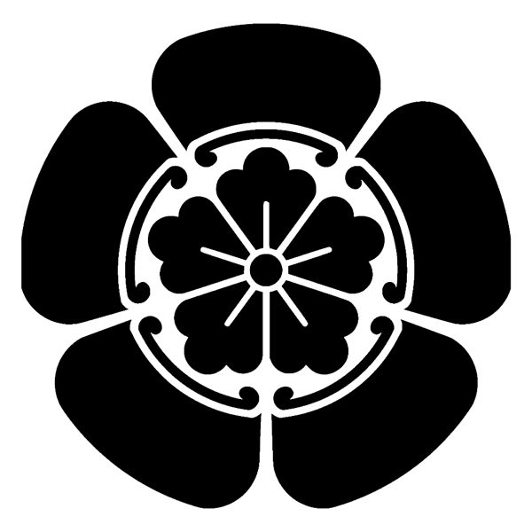
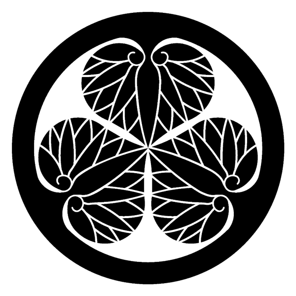
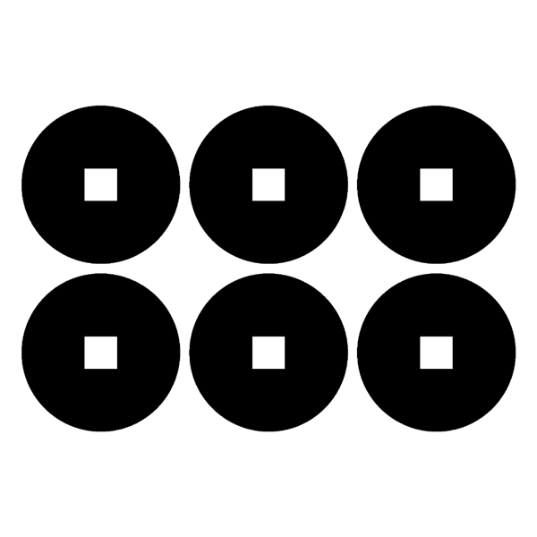
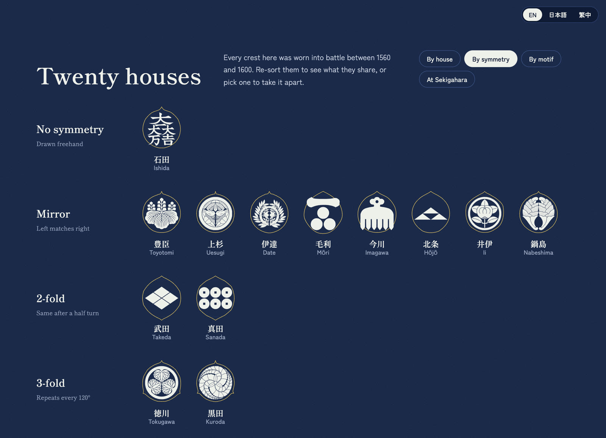
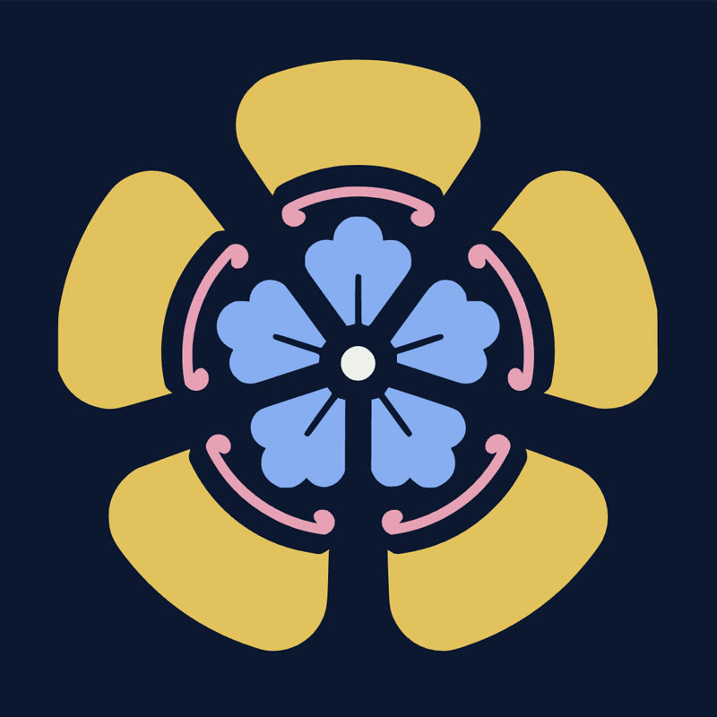
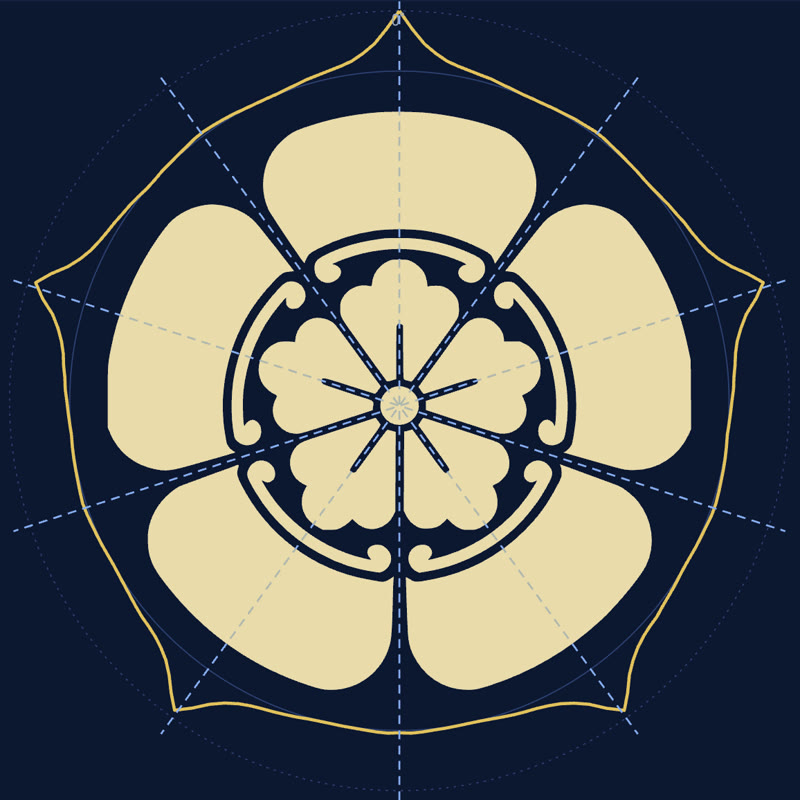
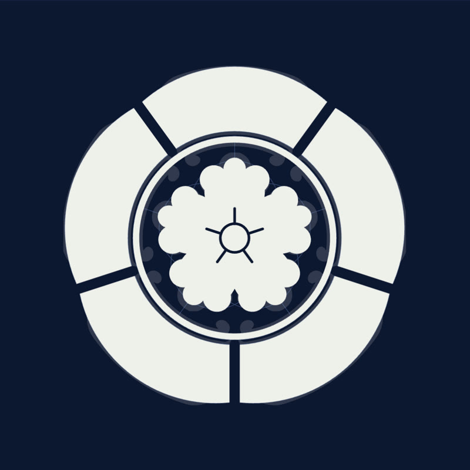
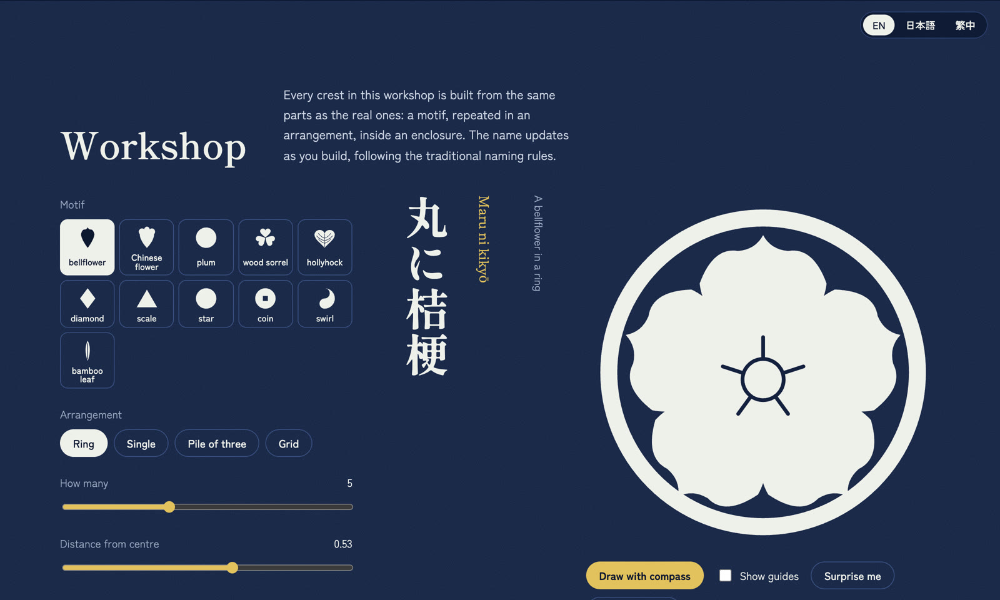
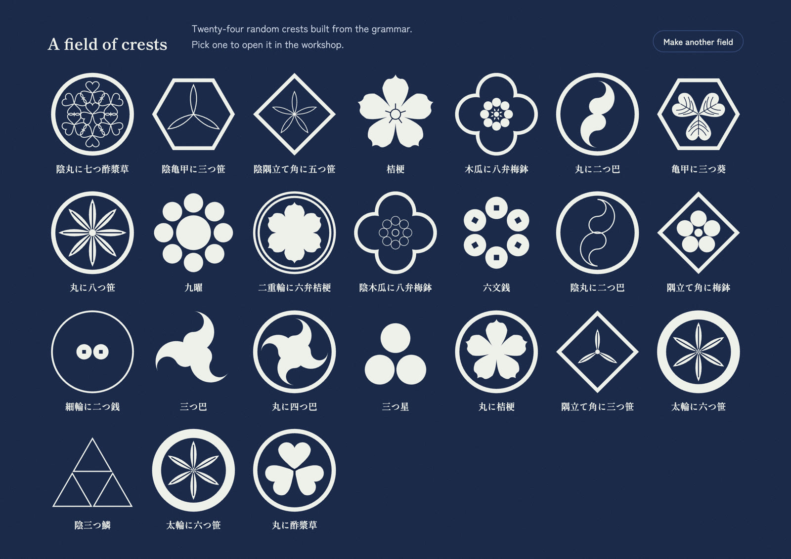

# Kamon, taken apart

*October 2026 · rough draft*

I've grown a deep interest in *kamon* (家紋 / かもん), the family crests often seen at castles, shrines, and temples from the *bushi* (武士 / ぶし) era, throughout my 18 trips to almost every part of Japan.
I wanted to see how such complex designs come from just a compass and a ruler.

[Try the interactive page →](https://bchao1.github.io/kamon/)


## Why kamon

*Draft notes:*

- Where I first noticed them (which trip, which castle or temple)
- What makes them interesting: a whole family identity in one flat, black-and-white shape
- The Sengoku period (1560–1600): crests worn on banners, armor, and roof tiles

```row 1:1:1:1




caption: Four of the twenty houses. Crest drawings from [Wikimedia Commons](https://commons.wikimedia.org/wiki/Category:SVG_Japanese_family_crests): Oda by Mukai (CC BY-SA 3.0), Tokugawa by Mukai (CC BY-SA 3.0), Takeda and Sanada by Los688 (public domain).
```

## Twenty houses, sorted by symmetry

*Draft notes:*

- Twenty crests from the houses that fought between 1560 and 1600
- Sorting by symmetry: most are mirror-symmetric or n-fold rotational, only one is freehand
- How symmetry is measured: overlap of each crest with rotated and mirrored copies of itself



## Taking a crest apart

*Draft notes:*

- Five views of each crest: whole, pieces, symmetry, unit, compass
- Repeated pieces are found automatically by tracing each connected piece of ink and grouping pieces of the same size

```row 1:1:1



caption: The Oda crest (織田木瓜), taken apart three ways.
```

```row 1:2


```

## Drawing your own

*Draft notes:*

- Every crest is a motif, repeated in an arrangement, inside an enclosure
- The workshop names each new crest by the traditional rules, e.g. 丸に桔梗 (*maru ni kikyō*, bellflower in a ring)





## What I learned

TODO
